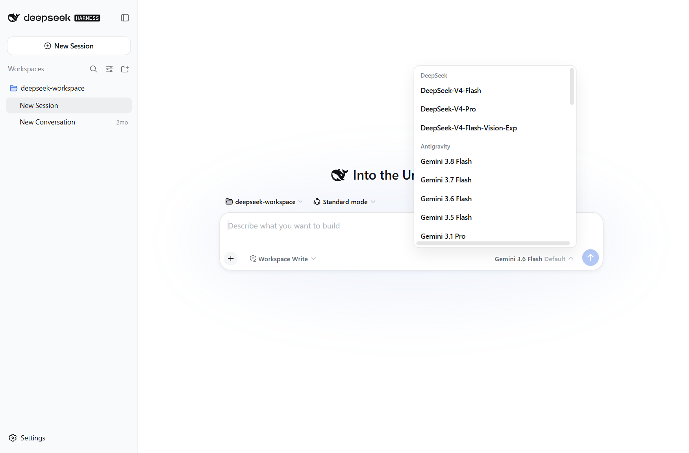
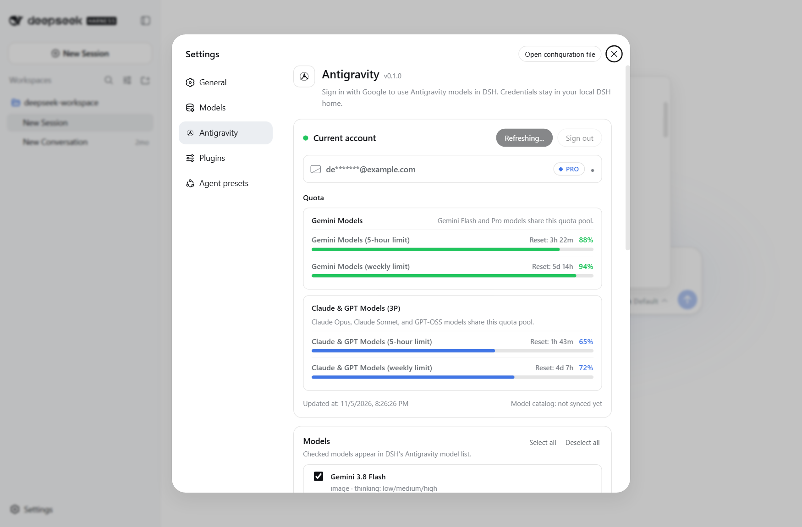
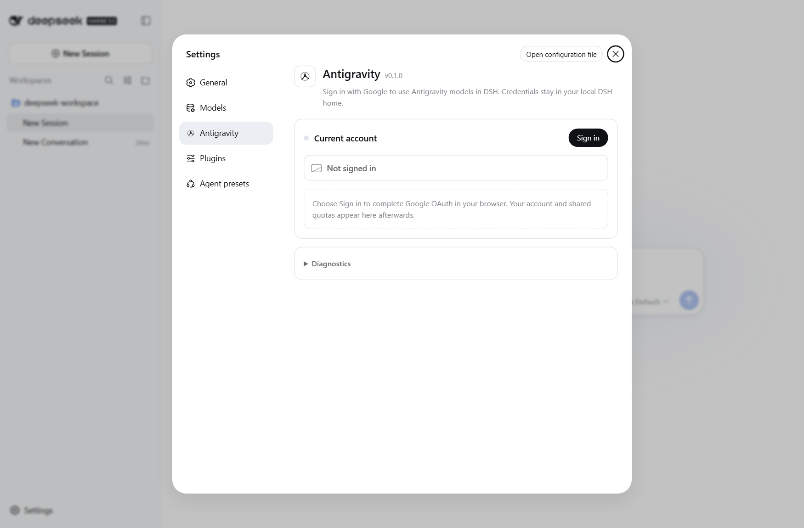

# dsh-antigravity

<p align="center">
  
</p>

An independent Google Antigravity / Cloud Code Assist model provider for
[DeepSeek Harness](https://github.com/deepseek-ai/deepseek-harness) (`dsh`).

The plugin signs in with Google OAuth, discovers the models your account can
use, and exposes them to DSH as the `antigravity` provider. It runs entirely
inside DSH: no Antigravity desktop app, language server, or external CLI is
required after installation.

> This is a community adapter. It is not affiliated with, endorsed by, or
> supported by Google or DeepSeek.

<p align="center">
  
</p>

## Highlights

- **Live model catalog first.** The picker is built from the models the
  backend actually advertises for your account, then grouped into stable
  public IDs. A bundled catalog is used only when discovery is unavailable.
- **New models are enabled automatically.** Models that appear after an
  upgrade work without hunting through settings. Explicit opt-outs survive
  catalog refreshes.
- **Current model families.** Bundled fallbacks include Gemini 3.8 / 3.7 /
  3.6 / 3.5 Flash, Gemini 3.1 Pro, Claude Opus 5.5, Claude Sonnet 5.5, legacy
  Claude 4.6, and GPT-OSS 120B.
- **Durable image input.** Attachments referenced by the attachment service
  are resolved and sent as inline image data with a model-facing handle, so
  images survive request compaction and history replay.
- **Transport hardening.** Gzip responses, truncated JSON, OAuth token
  refresh, region-gated endpoints, empty responses, and stalled streams are
  handled explicitly.
- **Unicode-safe text.** Emoji and other supplementary-plane characters are
  preserved; only lone UTF-16 surrogates are replaced.
- **Privacy defaults.** Account emails are masked in the settings UI and
  diagnostic text redacts bearer tokens, refresh tokens, client secrets, and
  authorization headers.
- **Theme-aware UI.** The settings pane uses DSH theme tokens, so light and
  dark themes, focus rings, and reduced-motion preferences all work.
- **Clean plugin lifecycle.** The navigation observer, animation frame,
  locale registrations, and polling intervals are disposed when the plugin
  unloads.

## Requirements

- Node.js 20 or newer (Node 24 recommended).
- DSH `0.1.1-rc.2` or newer.
- A Google account that can sign in to Antigravity / Cloud Code Assist.
- The `web` profile if you want the settings UI. The host adapter and CLI
  login also work in other DSH profiles.

## Installation into DSH

### Option 1: Direct from GitHub

```powershell
dsh plugin --profile web add github:aditya-deokar/dsh-antigravity
```

### Option 2: Local working copy (Development)

From the repository root:

```powershell
node scripts/install-local.mjs web
```

The script removes any previous `dsh-antigravity` copy from the profile and
links this directory instead. You can also run the underlying commands:

```powershell
dsh plugin --profile web remove dsh-antigravity
dsh plugin --profile web add link:"C:\path\to\dsh-antigravity"
```

Restart the web server after installing:

```powershell
dsh web --no-open --port 3123
```

Open <http://127.0.0.1:3123>, then go to **Settings → Antigravity**.

## Sign in

1. Open **Settings → Antigravity**.
2. Choose **Sign in**. A Google OAuth page opens in a new tab.
3. Approve access. DSH receives the callback on `127.0.0.1` and stores the
   refresh token locally.
4. Return to settings. The account and shared quota summary refresh
   automatically.

<p align="center">
  
</p>

The OAuth client identifies as the Antigravity Cloud Code Assist client so the
backend accepts the `aicode` scope. Credentials are stored at:

```
~/.dsh/storages/antigravity-oauth.json
```

Model selection is stored separately at:

```
~/.dsh/storages/antigravity-settings.json
```

Both paths match the original plugin's storage layout, so existing local
credentials keep working.

### Headless / terminal login

```powershell
npx dsh-antigravity-login
npx dsh-antigravity-login --logout
```

The package also exposes the compatibility alias `antigravity-login`.

## Models and settings

The settings page has three parts:

- **Account** — masked email, plan badge, quota windows, reset times, and the
  last refresh time.
- **Models** — checkboxes for every model in the current catalog. Changes save
  immediately and emit `llm/adapters-updated` so the model picker refreshes.
- **Diagnostics** — the last endpoint, runtime model match, HTTP status,
  project ID, redacted error, credential path, and transport mode. Useful when
  filing a bug report; copy it with one button.

If the live catalog cannot be fetched, the bundled catalog keeps the provider
usable. The UI shows which source is active.

## Configuration

| Variable | Purpose |
| --- | --- |
| `ANTIGRAVITY_BASE_URL` | Override the Cloud Code Assist endpoint. |
| `ANTIGRAVITY_RUNTIME_MODEL` | Force a backend runtime model ID for debugging. |
| `ANTIGRAVITY_CLIENT_ID` | Override the OAuth client ID. |
| `ANTIGRAVITY_CLIENT_SECRET` | Override the OAuth client secret. |

The sandbox endpoint is deliberately **not** in the fallback list. It rejects
some accounts by region and has produced misleading `fetch failed` errors.
Set `ANTIGRAVITY_BASE_URL` if you specifically need it.

## Compatibility notes

- **DSH LLM API drift.** Newer DSH releases export `ToolCallId`; older ones
  export `CallId`. The adapter resolves whichever exists at runtime.
- **Image attachments.** Durable image input requires DSH's attachment
  service. If the service is absent, the adapter returns a clear
  `UNSUPPORTED_CONTENT` error instead of silently dropping the image.
- **OAuth refresh.** Token refresh accepts gzip-encoded responses and
  malformed JSON without crashing the stream.
- **Endpoint retries.** Region-gated 400 responses fall through to the next
  endpoint; model-not-found responses fall through to the next runtime
  candidate.

## Development

```powershell
npm run verify   # syntax checks + unit tests
npm test         # unit tests only
npm run check    # node --check on every source file
```

Tests cover Unicode sanitization, secret redaction, email masking, JSON
parsing, runtime ID canonicalization, effort parsing, and enable-list
migration. They do not require network access or an OAuth account.

### Architecture

| File | Responsibility |
| --- | --- |
| `lib/index.js` | Cordis host plugin, OAuth flow, credential store, model catalog, request/stream adapter, web API. |
| `lib/client.js` | Browser-side settings section, model picker, diagnostics panel, theme and navigation integration. |
| `lib/catalog.js` | Pure model-ID canonicalization, effort extraction, and enable-list migration. |
| `lib/text.js` | Unicode sanitization, email masking, secret redaction, safe JSON parsing. |
| `bin/dsh-antigravity-login.mjs` | Terminal OAuth helper. |
| `scripts/install-local.mjs` | Local profile installer. |

The web API is mounted at `/antigravity/api`:

| Route | Method | Purpose |
| --- | --- | --- |
| `/antigravity/api/status` | GET | Account, models, cached quota, catalog source. |
| `/antigravity/api/login` | POST | Start the browser OAuth flow. |
| `/antigravity/api/quota` | GET/POST | Refresh quota and the live catalog. |
| `/antigravity/api/models` | GET/POST | Read or update the enabled model list. |
| `/antigravity/api/doctor` | GET | Redacted diagnostics text. |
| `/antigravity/api/logout` | POST | Delete stored credentials. |

## Troubleshooting

**Sign in opens but the callback never completes.**
Make sure the browser can reach `127.0.0.1` and that another process is not
holding the callback port. Retry from a normal browser window rather than an
embedded webview.

**The model list is empty.**
Choose **Refresh** in the Antigravity settings. If the backend is unreachable,
the bundled catalog is used and the UI labels it accordingly.

**Requests fail with `fetch failed`.**
Check network access to `cloudcode-pa.googleapis.com` and
`daily-cloudcode-pa.googleapis.com`. If your account only works through the
sandbox endpoint, set `ANTIGRAVITY_BASE_URL` explicitly.

**Images are rejected.**
Confirm the selected model supports image input. Text-only models return
`UNSUPPORTED_CONTENT` by design.

**Diagnostics contain a redacted value.**
That is expected. Tokens, secrets, and authorization headers are scrubbed
before the text reaches the UI.

## Privacy

- Credentials stay in the local DSH home directory.
- The settings page receives a masked email address, never the full address.
- Diagnostics redact OAuth tokens and common secret fields.
- No telemetry is sent by this plugin.
- Model requests go directly from your machine to Google's Cloud Code Assist
  endpoints.

## License

MIT. See [LICENSE](LICENSE). Portions derive from the original
`dsh-antigravity` project and remain under the same MIT terms.
